# 🤝 Cooperative Gig Services Platform

<p align="center">
  <strong>Smart India Hackathon 2026 · Problem Statement 26089</strong>
</p>

<p align="center">
  A Cooperative-Owned Digital Marketplace for Household & Community Services
</p>

<p align="center">
  Connecting customers with skilled local workers through service discovery, transparent bookings, cooperative workforce management, and AI-assisted demand intelligence.
</p>

<p align="center">
  <a href="https://cooperative-gig-platform.onrender.com/">🌐 Live Demo</a> •
  <a href="#-screenshots">Screenshots</a> •
  <a href="#-features">Features</a> •
  <a href="#-system-architecture">Architecture</a> •
  <a href="#-getting-started">Getting Started</a>
</p>

<p align="center">
  
  
  
  
  
  
  
</p>

---

## ✨ Overview

**Cooperative Gig Services Platform** is a full-stack digital service marketplace developed around **Smart India Hackathon 2026 — Problem Statement 26089**.

The platform aims to connect customers with skilled local workers while supporting cooperative-based workforce management, service discovery, booking coordination, job tracking, notifications, and administrative operations.

Unlike conventional gig marketplaces, the concept focuses on a cooperative-oriented service ecosystem where workers can manage their professional profiles, receive service requests, maintain availability, and build customer trust through ratings and reviews.

The platform combines:

- A **Spring Boot 3 backend** for REST APIs and business workflows
- **MySQL 8** with JPA/Hibernate for relational persistence
- A browser-based **HTML, CSS and JavaScript frontend**
- A standalone **Python FastAPI AI microservice**
- **Scikit-Learn** for demand forecasting and workforce intelligence
- A **Flutter mobile application foundation**
- **Docker Compose** for infrastructure orchestration

The repository represents an academic and hackathon prototype, with implemented functionality and proposed production extensions clearly distinguished.

## 🎯 Problem Statement

Labour Cooperative Societies and Federations have skilled workers across trades such as plumbing, electrical work, cleaning, carpentry, painting, driving, cooking, laundry, and construction.

However, customers may find it difficult to discover nearby verified workers, while workers and cooperative administrators need better tools to coordinate availability, requests, schedules, and service delivery.

The platform addresses this challenge through a centralized digital marketplace.

### Project Objectives

- Make cooperative workers easier to discover.
- Enable customers to browse services and request assistance.
- Support worker onboarding and professional profiles.
- Improve booking and job-status coordination.
- Provide administrative workforce management.
- Introduce AI-assisted demand forecasting.
- Support location-aware workforce recommendations.
- Improve operational visibility through notifications and analytics.
- Provide web and mobile access to platform workflows.

## 🚀 Features

### 👤 Customer Experience

Customers can use the platform to:

- Register and log in.
- Verify email through OTP workflows.
- Browse service categories.
- Explore worker profiles.
- Search workers by skills.
- Discover workers by city and locality.
- View worker experience and ratings.
- Create service requests.
- Select preferred dates and time slots.
- View booking progress.
- Receive booking notifications.
- Track service requests.
- Rate completed services.
- Submit customer reviews.
- Raise complaints and disputes.
- View booking history.

### 🧑‍🔧 Worker Portal

Workers receive a dedicated interface for managing their professional activities.

- Worker registration and authentication
- Professional profile management
- Skill and experience information
- Location and service-area information
- Availability management
- Working schedule configuration
- Incoming booking requests
- Accept and reject service requests
- Job-status updates
- Completed-work tracking
- Customer ratings and reviews
- Worker verification status

Worker passwords are encoded using **BCrypt** before database persistence.

### 🏛️ Admin & Cooperative Management

The administration module supports centralized platform oversight.

| Module | Capabilities |
|---|---|
| Dashboard | Platform metrics and operational overview |
| Worker Management | Worker listing and profile monitoring |
| Verification | Review and update worker verification status |
| Customer Management | View registered customer records |
| Booking Management | Monitor service requests and booking progress |
| Dispute Management | Review complaints and manage resolutions |
| Workforce Intelligence | Inspect AI-assisted workforce insights |
| Worker Activation | Trigger workforce activation and notification workflows |

### 📅 Service Booking System

The booking engine coordinates service requests between customers and workers.

Customers can select a service, choose a worker, provide location details, and submit preferred scheduling information.

**Booking lifecycle:**

```text
PENDING
   ↓
ASSIGNED
   ↓
ACCEPTED
   ↓
ON_THE_WAY
   ↓
STARTED / IN_PROGRESS
   ↓
COMPLETED
   ↓
PAID
   ↓
RATED
```

**Alternative booking states:**

```text
CANCELLED
REJECTED
DISPUTED
```

The backend includes validation around important lifecycle transitions.

Examples:

- A worker must accept a booking before proceeding to the travel stage.
- Invalid job-status transitions are rejected.
- Completed or settled bookings cannot be cancelled through arbitrary status changes.
- Ratings are constrained to the range of 1.0–5.0.
- Worker request updates are checked against the assigned worker context.

### 🔔 Notification System

The platform includes a database-backed notification subsystem.

Notifications support operational events such as:

- New service requests
- Booking acceptance
- Worker travel status
- Job commencement
- Job completion
- Booking rejection
- Customer ratings
- Disputes
- Administrative workforce actions

The notification API provides:

```http
GET   /api/notifications
GET   /api/notifications/unread-count
PATCH /api/notifications/{id}/read
POST  /api/notifications/mark-all-read
```

### 📍 Location-Aware Worker Discovery

Location information is used to support workforce discovery and analysis.

- City-based worker filtering
- Skill-based worker filtering
- Availability filtering
- Worker latitude and longitude
- Nearby-worker discovery
- Geographic distance calculations
- Area-specific demand analysis

The AI intelligence service uses the **Haversine distance calculation** when evaluating geographic proximity for worker recommendations.

### 🌐 Multilingual Interface

The web interface includes runtime language support for:

- English
- हिन्दी (Hindi)

The language switcher allows the interface to be presented in either language.

### 💰 Cooperative-Oriented Model

The platform is designed around a cooperative service marketplace that emphasizes direct community connections and transparent service workflows.

The demonstration interface communicates a direct-worker-earnings and low-middleman approach. However, production payment settlement, escrow, and revenue distribution are not implemented as a live financial processing system.

## 🧠 AI Workforce Intelligence

The project includes a standalone Python microservice dedicated to workforce demand forecasting and allocation recommendations.

### Technology

- Python
- FastAPI
- Scikit-Learn
- RandomForestRegressor
- Pandas
- NumPy

### AI Capabilities

The AI service supports:

- Service demand forecasting
- Demand scoring
- Demand-level classification
- Workforce capacity analysis
- Localized shortage detection
- Workforce allocation recommendations
- District and locality-aware analysis
- Time-window analysis
- Geographic worker recommendations
- Explainable operational insights
- Model retraining endpoint

### Demand Classification

```text
LOW
MODERATE
HIGH
CRITICAL
```

### AI Workforce Flow

```text
       Platform Information
                │
       ┌────────┼────────┐
       │        │        │
       ▼        ▼        ▼
    Workers  Bookings  Services
       │        │        │
       └────────┼────────┘
                │
                ▼
        FastAPI AI Service
                │
                ▼
       Random Forest Model
                │
                ▼
          Demand Score
                │
       ┌────────┼─────────┐
       │        │         │
       ▼        ▼         ▼
   Demand   Workforce  Shortage
    Level     Gap     Detection
                │
                ▼
       Allocation Insights
```

The model uses generated baseline/synthetic historical data for training. The Spring Boot workforce intelligence layer also retrieves platform information such as workers, service requests, and services for its operational analysis.

AI predictions are decision-support outputs, not guaranteed forecasts.

## 📸 Screenshots

Explore the platform's customer, worker, booking, tracking, and administrative interfaces.

### 🏠 Platform Dashboard

<p align="center">
  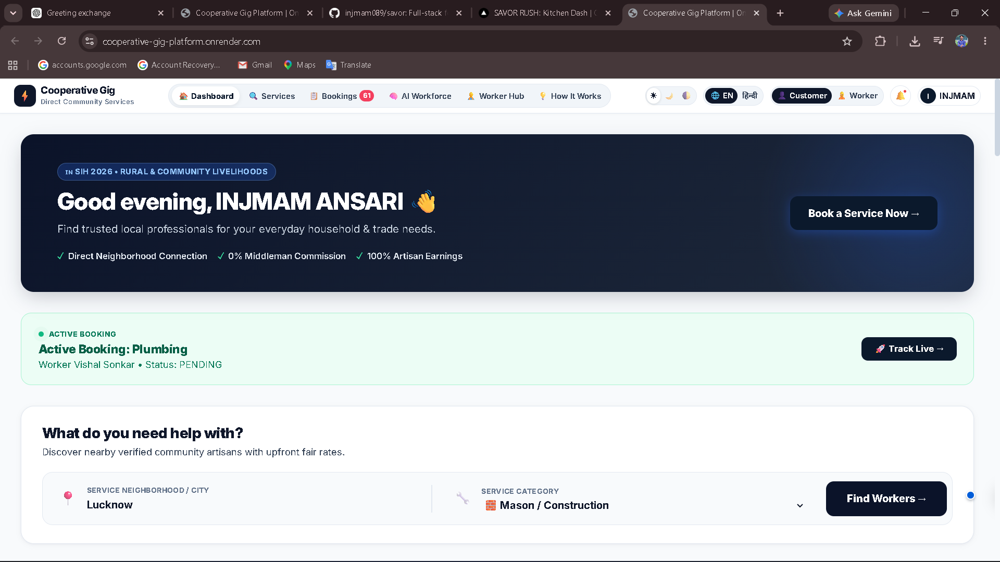
</p>

### 🧠 AI Workforce Intelligence

<p align="center">
  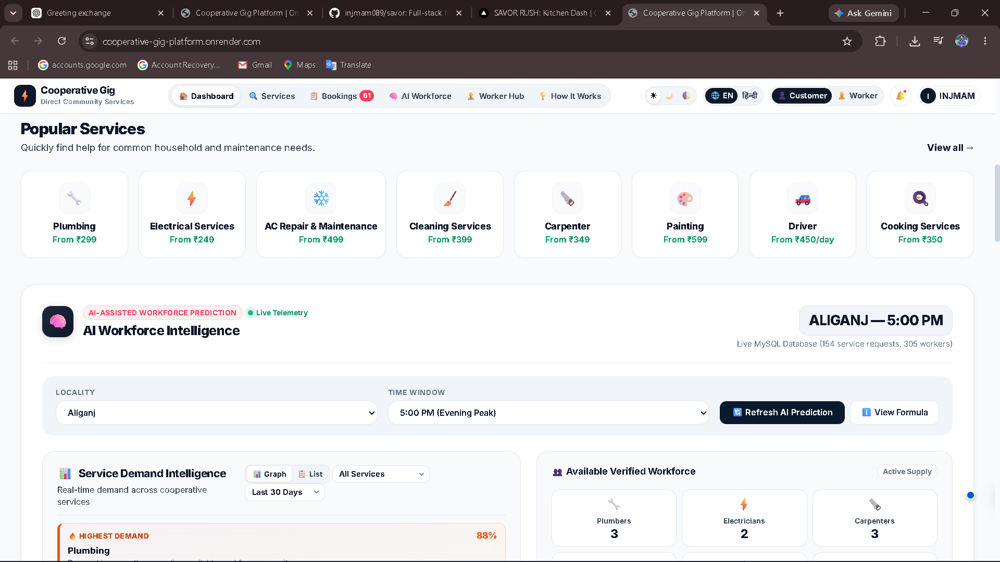
</p>

### 🚨 Emergency Services

<p align="center">
  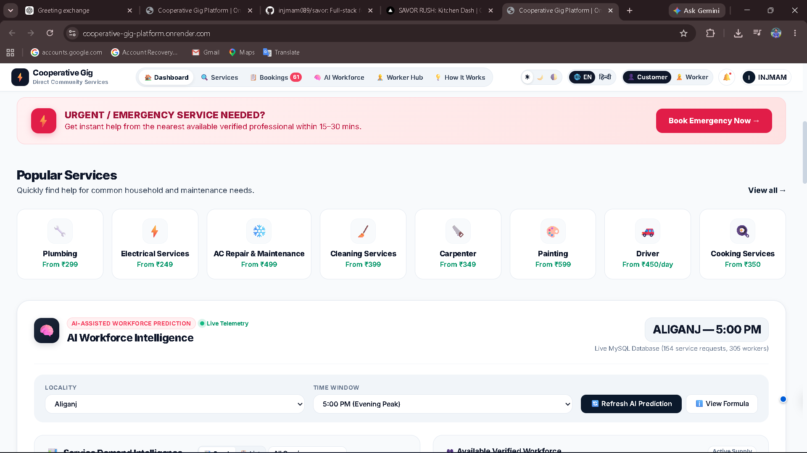
</p>

### 📅 Booking Management

<p align="center">
  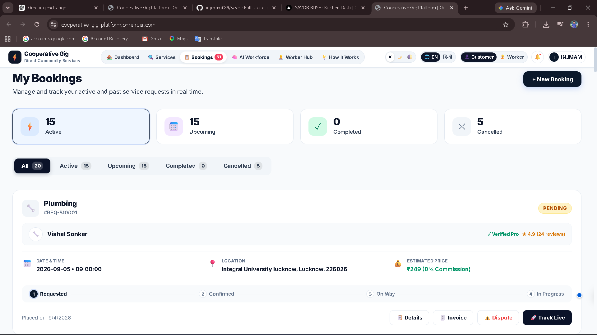
</p>

### 📍 Live Service Tracking

<p align="center">
  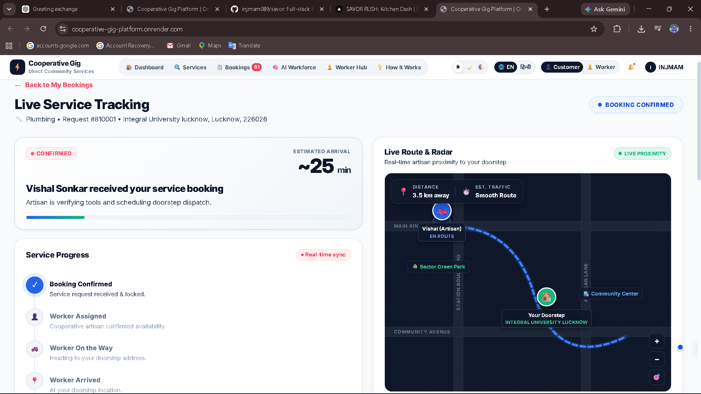
</p>

### 🧑‍🔧 Worker Dashboard

<p align="center">
  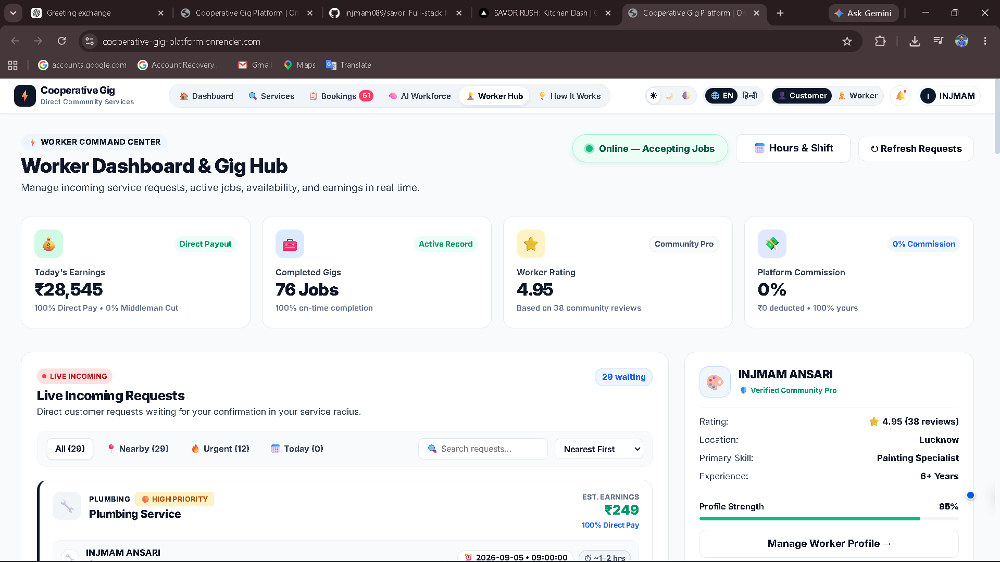
</p>

### 🏛️ Admin Dashboard

<p align="center">
  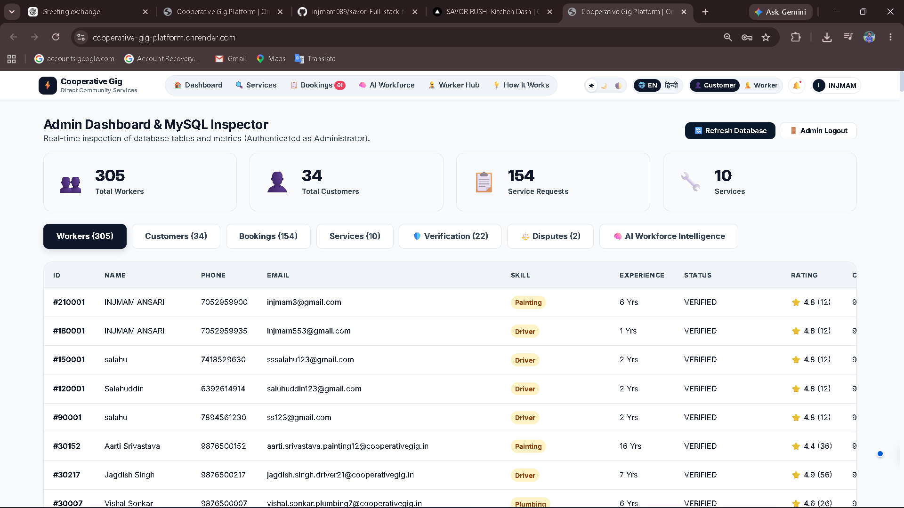
</p>

## 🏗️ System Architecture

The platform uses a multi-component architecture with Spring Boot as the central backend.

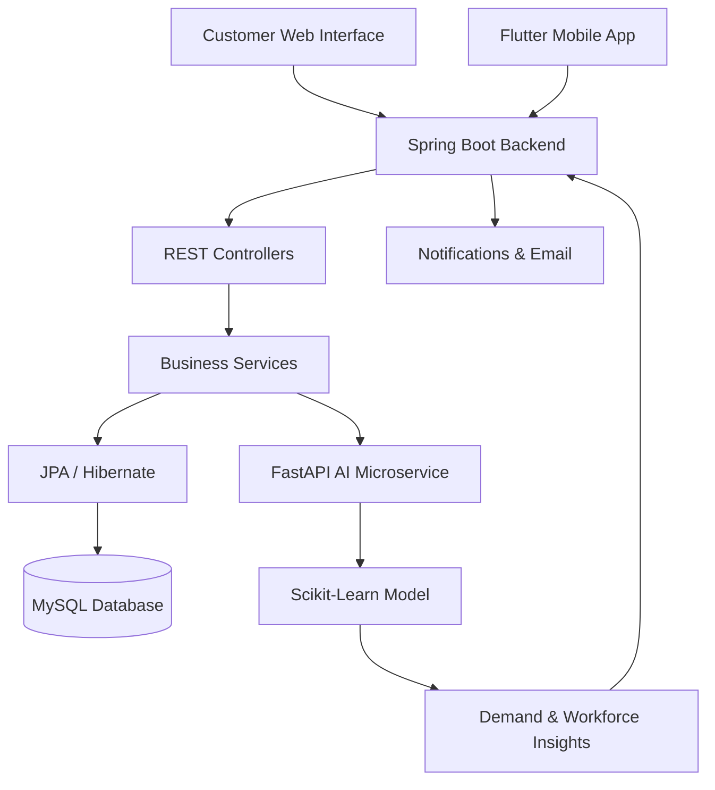

### Core Components

| Component | Responsibility |
|---|---|
| Web Frontend | Customer, worker and admin interfaces |
| Spring Boot | Central application backend |
| REST Controllers | HTTP request and response handling |
| Services | Booking and business workflows |
| Repositories | Database access |
| JPA/Hibernate | Object-relational mapping |
| MySQL | Persistent relational storage |
| FastAPI | AI microservice endpoints |
| Scikit-Learn | Demand forecasting model |
| Flutter | Cross-platform mobile client |

## 🔄 Core Booking Workflow

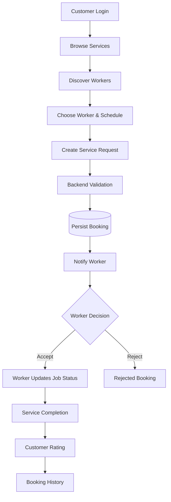

## 🧩 Backend Architecture

The Java application follows a layered architecture.

```text
Controller
    ↓
Service
    ↓
Repository
    ↓
JPA Entity
    ↓
MySQL
```

### Backend Layers

| Layer | Responsibility |
|---|---|
| Controllers | REST API endpoints |
| DTOs | Request and response data transfer |
| Services | Business rules and workflows |
| Repositories | Data access and database operations |
| Models | JPA entities |
| Security | Authentication and authorization configuration |
| Exception Handler | Centralized error handling |
| Initializer | Demonstration data initialization |

## 🗄️ Database Architecture

The platform uses MySQL 8 with JPA/Hibernate.

### Core Entities

| Entity | Description |
|---|---|
| `customers` | Customer and administrator records |
| `workers` | Worker profiles, skills and availability |
| `services` | Service catalogue |
| `service_requests` | Customer bookings and job progress |
| `notifications` | User notification records |
| `otp_verifications` | OTP verification workflow data |

### Database Relationships

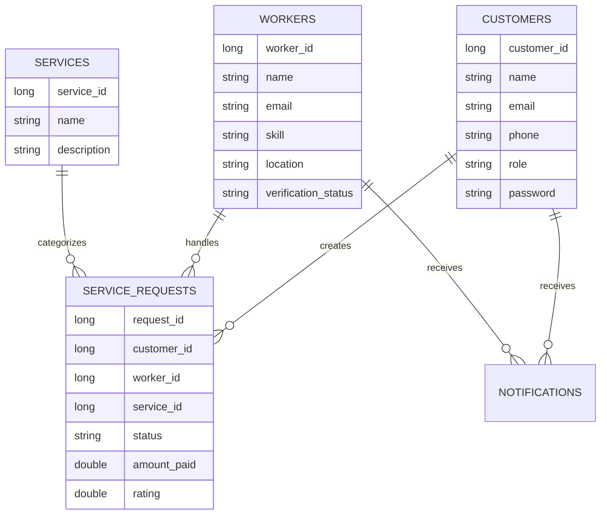

### Seeded Service Categories

The demonstration dataset includes ten service categories:

1. Plumbing
2. AC Repair & Maintenance
3. Cooking Services
4. Driver
5. Electrical Services
6. Cleaning Services
7. Carpenter
8. Painting
9. Mason / Construction
10. Laundry

## 🔌 REST API Overview

The Spring Boot backend exposes REST endpoints for the platform's core modules.

### Customer APIs

```http
POST /api/customers
POST /api/customers/login
POST /api/customers/logout
POST /api/customers/send-otp
POST /api/customers/verify-otp

GET  /api/customers
GET  /api/customers/{id}
GET  /api/customers/me
```

### Worker APIs

```http
POST /api/workers
POST /api/workers/login
POST /api/workers/logout

GET  /api/workers
GET  /api/workers/{id}
GET  /api/workers/me
GET  /api/workers/nearby

PUT  /api/workers/{id}/availability
PUT  /api/workers/{id}/schedule
```

### Service APIs

```http
GET /api/services
GET /api/services/{id}
```

### Booking APIs

The service-request controller is mapped to both `/api/service-requests` and `/api/bookings`.

Representative operations include:

```http
POST  /api/service-requests
GET   /api/service-requests/{id}
PATCH /api/service-requests/{id}/status

POST  /api/service-requests/{id}/rate
POST  /api/service-requests/{id}/dispute
POST  /api/service-requests/{id}/resolve-dispute
```

### Admin APIs

```http
POST  /api/admin/login
POST  /api/admin/logout

GET   /api/admin/dashboard
GET   /api/admin/workers
GET   /api/admin/customers
GET   /api/admin/bookings
GET   /api/admin/complaints

PATCH /api/admin/workers/{id}/verify
```

### Workforce Intelligence APIs

```http
GET  /api/ai/intelligence
GET  /api/workforce/predictions
GET  /api/admin/ai/intelligence

POST /api/workforce/activate-worker/{workerId}
POST /api/admin/ai/notify-worker/{workerId}
```

## 🤖 AI Service API

The standalone FastAPI service runs on port `8000`.

| Method | Endpoint | Purpose |
|---|---|---|
| GET | `/health` | Service health |
| GET | `/ai/workforce-intelligence` | Workforce insights |
| POST | `/ai/workforce-intelligence` | Workforce intelligence request |
| GET | `/predict/demand` | Demand forecasting |
| GET | `/predict/workforce-allocation` | Workforce allocation |
| POST | `/train` | Model retraining |

### Demand Prediction Example

```http
GET /predict/demand?category=Plumbing&district=Lucknow&dayOfWeek=6&hourOfDay=17&isEmergency=0&activeWorkers=8
```

### Interactive API Documentation

When the AI service is running, open:

```text
http://localhost:8000/docs
```

FastAPI provides interactive Swagger documentation for the service endpoints.

## 📱 Flutter Mobile Application

The repository includes a Flutter application foundation under `mobile_app/`.

### Mobile Technology Stack

- Flutter
- Dart
- HTTP
- Provider
- Shared Preferences
- Intl
- Cupertino Icons

### Current Structure

```text
mobile_app/
├── lib/
│   ├── main.dart
│   ├── models/
│   │   └── models.dart
│   └── services/
│       └── api_service.dart
│
├── pubspec.yaml
└── README.md
```

The mobile client is designed to consume the Spring Boot REST APIs.

## 🧰 Technology Stack

### Backend

| Technology | Purpose |
|---|---|
| Java 17 | Backend language |
| Spring Boot 3.3.4 | Application framework |
| Spring Web | REST APIs |
| Spring Data JPA | Persistence abstraction |
| Hibernate | ORM |
| Spring Security | Security configuration |
| Spring Validation | Request validation |
| BCrypt | Password hashing |
| JJWT 0.12.6 | JWT library dependency |
| Spring Mail | Email and OTP support |
| MySQL Connector/J | Database connectivity |
| H2 | Automated test database |

### Frontend

- HTML5
- CSS3
- Vanilla JavaScript
- Responsive layouts
- English/Hindi localization

### AI / Machine Learning

| Technology | Purpose |
|---|---|
| Python | AI service language |
| FastAPI | AI REST service |
| Scikit-Learn | Machine learning |
| RandomForestRegressor | Demand forecasting |
| Pandas | Data processing |
| NumPy | Numerical processing |

### Mobile

- Flutter
- Dart
- Provider
- HTTP
- Shared Preferences
- Intl

### Database & DevOps

- MySQL 8
- JPA/Hibernate
- SQL
- Docker
- Docker Compose
- Maven Wrapper
- Git and GitHub

## 🔐 Authentication & Security

The backend includes several security-related components.

- Spring Security configuration
- BCrypt password hashing
- Customer and worker authentication workflows
- OTP verification
- Session-aware application operations
- Request validation
- Centralized exception handling
- CORS configuration
- Environment-driven database configuration

**Authentication implementation note:** The project includes JJWT libraries in Maven dependencies, while the current Spring Security configuration also uses session-based authentication for application workflows. The repository should not be described as a fully JWT-only authentication architecture.

### Production Security Checklist

Before production use, review:

- Endpoint-level authorization
- Session and CSRF strategy
- CORS allowlists
- Rate limiting
- Brute-force protection
- Secret management
- HTTPS enforcement
- Security headers
- Audit logging
- Personal information minimization
- OTP expiry and verification limits
- Database access permissions
- Secure document handling
- Dependency vulnerability scanning

Never commit real database passwords, SMTP credentials, JWT secrets, API keys, or production configuration to GitHub.

## ⚙️ Configuration

The Spring Boot application uses environment-driven database and email configuration.

### Database Variables

```env
DB_HOST=localhost
DB_PORT=3306
DB_NAME=sih_db
DB_USERNAME=root
DB_PASSWORD=replace-with-your-password
```

Equivalent Spring datasource properties can also be supplied:

```env
SPRING_DATASOURCE_URL=jdbc:mysql://localhost:3306/sih_db
SPRING_DATASOURCE_USERNAME=root
SPRING_DATASOURCE_PASSWORD=replace-with-your-password
```

### Email / OTP Variables

```env
MAIL_HOST=smtp-relay.brevo.com
MAIL_PORT=587
MAIL_USERNAME=your-smtp-username
MAIL_PASSWORD=your-smtp-password
MAIL_FROM=no-reply@example.com
MAIL_FROM_NAME=Cooperative Gig Services
MAIL_ENABLED=true
```

### AI Service URL

The backend supports configuration of its AI service base URL through:

```text
ai.service.url
```

For local development, the AI service normally runs at:

```text
http://localhost:8000
```

For container networking, configure the backend to use the AI service's internal Docker hostname and port.

Create your own local environment configuration. Do not commit real credentials.

## 🐳 Docker Architecture

Docker Compose defines three main services:

| Service | Purpose | Port |
|---|---|---|
| `mysql-db` | MySQL database | Internal 3306 |
| `backend` | Spring Boot application | 8088 |
| `ai-service` | FastAPI AI service | 8000 |

### Infrastructure Flow

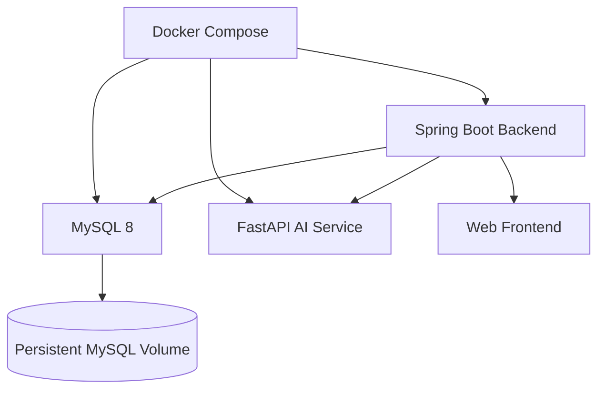

The backend service waits for the MySQL health check before starting.

The Compose file contains demonstration database configuration. Replace demonstration credentials and configure the AI service URL appropriately before using the stack beyond local development.

## 🚀 Getting Started

Choose one of the following options to run the platform.

### Prerequisites

Install the following tools:

- JDK 17 or newer
- MySQL 8 or newer
- Python 3.9 or newer
- Flutter 3.x or compatible SDK
- Docker and Docker Compose
- Git

Maven is optional because the repository includes the Maven Wrapper.

### 1. Clone the Repository

```bash
git clone https://github.com/injmam089/cooperative-gig-platform.git

cd cooperative-gig-platform
```

### 2. Option A — Run with Docker Compose

The Docker Compose configuration starts MySQL, the backend, and the AI service.

```bash
docker compose up --build
```

Expected service endpoints:

```text
Web Application:
http://localhost:8088

AI Service:
http://localhost:8000

AI Swagger Documentation:
http://localhost:8000/docs
```

The database listens on port `3306` inside the Docker network.

Before relying on integrated AI functionality, verify that the backend's `ai.service.url` points to the AI container hostname.

### 3. Option B — Run Spring Boot Locally

Configure a local MySQL instance and provide the required database environment variables.

**Windows:**

```powershell
.\mvnw.cmd clean package
.\mvnw.cmd spring-boot:run
```

**Linux / macOS:**

```bash
chmod +x mvnw

./mvnw clean package
./mvnw spring-boot:run
```

Open the application:

```text
http://localhost:8088
```

### 4. Option C — Run the AI Service Locally

Navigate to the AI service directory:

```bash
cd ai_service
```

**Windows:**

```powershell
python -m venv venv
.\venv\Scripts\activate

pip install -r requirements.txt

uvicorn main:app --host 0.0.0.0 --port 8000 --reload
```

**Linux / macOS:**

```bash
python3 -m venv venv
source venv/bin/activate

pip install -r requirements.txt

uvicorn main:app --host 0.0.0.0 --port 8000 --reload
```

Open the API documentation:

```text
http://localhost:8000/docs
```

### 5. Option D — Run the Flutter Application

Ensure Flutter is installed:

```bash
flutter doctor
```

Navigate to the mobile application:

```bash
cd mobile_app

flutter pub get
flutter run
```

The API base URL may need to be adjusted depending on whether the application runs on an Android emulator, physical device, iOS simulator, or desktop environment.

For physical devices, use the development machine's LAN IP instead of `localhost` where appropriate.

## 🧪 Testing

The backend includes automated tests under:

```text
src/test/
```

Run the test suite:

**Windows:**

```powershell
.\mvnw.cmd test
```

**Linux / macOS:**

```bash
./mvnw test
```

The repository includes an integration test covering seeded database behavior and application startup/database interactions.

## 📜 Useful Development Commands

| Command | Description |
|---|---|
| `./mvnw clean package` | Build the Spring Boot application |
| `./mvnw spring-boot:run` | Run the backend |
| `./mvnw test` | Run backend tests |
| `uvicorn main:app --host 0.0.0.0 --port 8000 --reload` | Run AI service |
| `docker compose up --build` | Build and start container services |
| `docker compose down` | Stop container services |
| `docker compose down -v` | Stop services and remove the MySQL volume |

> **Warning:** `docker compose down -v` removes the persistent MySQL Docker volume and deletes the database data stored in it.

## 🔑 Demo Accounts

The `ServiceDataInitializer` creates demonstration accounts.

| Role | Email | Password |
|---|---|---|
| Customer | `customer@example.com` | `Password@123` |
| Worker — Plumber | `rahul.plumber@example.com` | `Password@123` |
| Worker — Electrician | `amit.electric@example.com` | `Password@123` |
| Worker — Carpenter | `sanjay.carpenter@example.com` | `Password@123` |
| Admin / Federation | `admin@sih.gov.in` | `Admin@123` |

Additional customer and worker records are seeded by the initializer.

> These credentials are for local demonstration only. Never reuse them for a real deployment.

## 🌱 Seeded Demonstration Dataset

The initialization process creates demonstration records including:

- 10 service categories
- 16 customer and administrator records
- 20 worker profiles
- Worker skills and experience
- Geographic information
- Verified and pending verification states
- Availability information
- Ratings and completed-job counts
- Service requests across different lifecycle states
- Notification-ready workflows

The dataset is intended for:

- Hackathon demonstrations
- UI testing
- API testing
- Database demonstrations
- Admin dashboard testing
- AI workforce intelligence demonstrations

These are sample records, not official customer or cooperative records.

## 📊 Current Implementation & Future Scope

The project combines implemented functionality with planned production extensions.

### Implemented / Represented in the Repository

- Spring Boot REST backend
- MySQL persistence
- JPA/Hibernate entities and repositories
- Customer registration and login
- Worker registration and login
- BCrypt password hashing
- OTP/email infrastructure
- Service catalogue
- Worker search and filtering
- Location-aware worker discovery
- Booking creation and lifecycle validation
- Notifications
- Ratings and reviews
- Dispute creation and resolution
- Admin dashboard APIs
- FastAPI AI service
- Random Forest demand forecasting
- Workforce intelligence endpoints
- Flutter mobile application foundation
- English/Hindi frontend localization
- Docker Compose infrastructure
- Demonstration seed dataset
- Automated backend test infrastructure

### Future Improvements

- [ ] Production payment gateway integration
- [ ] Real payment settlement and reconciliation
- [ ] Stronger multi-cooperative tenancy
- [ ] More granular endpoint authorization
- [ ] Production-grade authentication across clients
- [ ] Real-world demand telemetry instead of synthetic baseline data
- [ ] Persistent ML model and version registry
- [ ] Advanced map UI and live location tracking
- [ ] Cloud object storage for worker documents
- [ ] Document and KYC verification workflows
- [ ] Production push notification infrastructure
- [ ] CI/CD pipelines
- [ ] Observability and audit logging
- [ ] Automated security scanning
- [ ] Production deployment hardening

## 🧪 Example: Create a Service Request

A simplified service-request payload can look like:

```json
{
  "customerId": 1,
  "workerId": 1,
  "serviceId": 1,
  "description": "Kitchen sink leakage repair",
  "location": "Gomti Nagar, Lucknow",
  "preferredDate": "2026-10-05",
  "preferredTime": "10:00 AM - 12:00 PM"
}
```

The backend processes a request through the following workflow:

```text
Validate Customer
      ↓
Validate Worker
      ↓
Validate Service
      ↓
Check Booking Constraints
      ↓
Create PENDING Request
      ↓
Persist in MySQL
      ↓
Generate Notifications
```

## 📈 AI Demand Prediction Example

Example AI service request:

```http
GET /predict/demand?category=Plumbing&district=Lucknow&dayOfWeek=6&hourOfDay=17&isEmergency=0&activeWorkers=8
```

A response can contain information such as:

```json
{
  "category": "Plumbing",
  "district": "Lucknow",
  "demandScore": 72,
  "demandLevel": "HIGH",
  "rawDemandUnits": 27.4,
  "projectedWeeklyVolume": 173
}
```

> The values above are illustrative. Actual results are generated by the model at runtime.

## 🧠 Why This Architecture?

### Why Spring Boot?

Spring Boot provides:

- Structured REST APIs
- Dependency injection
- JPA/Hibernate integration
- Validation
- Security integration
- Email support
- Test infrastructure
- Layered backend architecture

### Why MySQL?

MySQL provides:

- Relational data integrity
- Foreign-key relationships
- Structured customer, worker, and booking data
- SQL-based database management
- Local and Docker deployment support

### Why FastAPI?

FastAPI separates machine-learning workloads from the Java backend.

Benefits include:

- Python ML ecosystem
- Independent model lifecycle
- API-based integration
- Interactive Swagger documentation
- Separation of application workflows and inference logic

### Why Random Forest?

The prototype uses `RandomForestRegressor` to model relationships between service category, district, time, emergency indicators, and workforce availability without requiring a deep-learning stack.

### Why Flutter?

Flutter provides a cross-platform mobile development foundation while allowing the mobile client to consume the same backend APIs.

## 🎓 Academic & Hackathon Value

This project demonstrates practical experience with:

- Full-stack application architecture
- REST API design
- Java and Spring Boot
- Relational database design
- JPA/Hibernate
- Authentication and password security
- OTP workflows
- Service booking systems
- State-transition validation
- Notification systems
- Administrative analytics
- AI/ML integration
- Microservice architecture
- Python and FastAPI
- Scikit-Learn
- Flutter mobile development
- Docker containerization
- Automated testing
- Git and GitHub workflows

## 🧭 Project Demonstration Flow

A typical end-to-end demonstration can follow these stages.

### 1. Customer

```text
Customer Login
      ↓
Browse Services
      ↓
Discover Workers
      ↓
Choose Service & Schedule
      ↓
Create Booking
```

### 2. Worker

```text
Worker Login
      ↓
Receive Booking Request
      ↓
Accept / Reject
      ↓
Update Job Status
      ↓
Complete Service
```

### 3. Customer

```text
View Booking Progress
      ↓
Confirm Service Completion
      ↓
Rate Worker
      ↓
Submit Review
```

### 4. Administrator

```text
Open Admin Dashboard
      ↓
Review Workers
      ↓
Inspect Bookings
      ↓
Review Disputes
      ↓
Open Workforce Intelligence
```

### 5. AI Workforce Intelligence

```text
Select Locality & Time Window
      ↓
Analyze Workforce and Booking Data
      ↓
Generate Demand Insights
      ↓
Identify Workforce Gaps
      ↓
Review Allocation Recommendations
```

## 🛡️ Prototype & Security Disclaimer

This repository is a **Smart India Hackathon / academic prototype**.

It should not be interpreted as a fully certified production cooperative marketplace.

Before production use, the platform requires appropriate:

- Security assessment
- Privacy and legal review
- Payment compliance
- Infrastructure hardening
- Operational monitoring
- Cooperative governance implementation
- Load and reliability testing
- Independent validation of AI recommendations
- Production-grade data protection

AI forecasts and workforce recommendations are decision-support outputs, not guaranteed predictions.

The demonstration dataset must not be confused with official university, customer, worker, or government records.

## 📄 License

A standalone `LICENSE` file is not currently included in this repository.

The project should therefore not be treated as having an explicitly granted open-source license until a license file is added.

Review third-party dependencies and their licenses before redistribution or commercial use.

## 👨‍💻 Author

**Injmam Ansari**

BCA Student | Full-Stack Development | Cybersecurity

<p>
  <a href="https://github.com/injmam089">
    
  </a>
</p>

**Repository:**  
https://github.com/injmam089/cooperative-gig-platform

**Live Demo:**  
https://cooperative-gig-platform.onrender.com/

---

<p align="center">
  <strong>🤝 Cooperative Gig Services Platform</strong>
  <br>
  Smart India Hackathon 2026 · Problem Statement 26089
  <br>
  Building a more connected cooperative service ecosystem.
</p>
